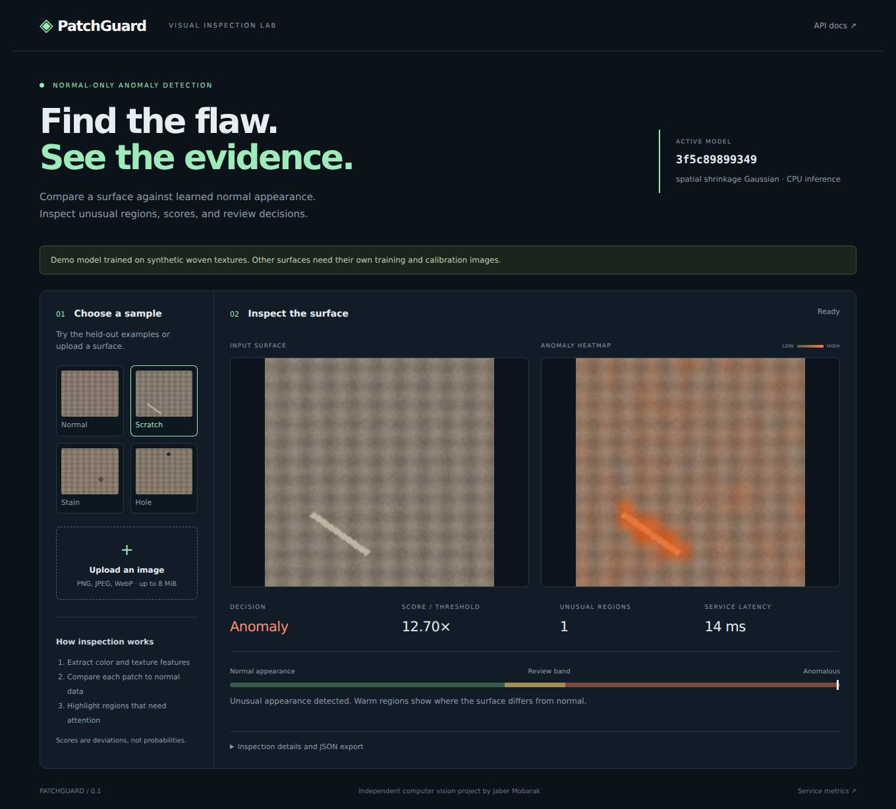

# PatchGuard

**Learn what a normal surface looks like. Find where it changes.**

PatchGuard is a CPU-based visual inspection service that learns from defect-free images and highlights unusual regions in new images. It includes an image upload interface, a REST API, separate threshold calibration, ONNX scoring export, and a reproducible benchmark.



[Four actual inspection examples](artifacts/inspection_examples.png)

## Run it

Python 3.11 or 3.12. No GPU, API key, or model download required. A pinned `requirements.lock` records the tested Python 3.12 dependencies.

```bash
python -m venv .venv
# Linux / macOS
source .venv/bin/activate
# Windows PowerShell: .venv\Scripts\Activate.ps1
pip install -e '.[dev]'
python -m uvicorn patchguard.api:app --host 127.0.0.1 --port 8000
```

Open **http://localhost:8000**. Choose normal, scratch, stain, or hole, or upload an image. The included model is already fitted to the demo texture; it must be retrained for a different surface.

Or use Docker:

```bash
docker build -t patchguard .
docker run --rm -p 127.0.0.1:8000:8000 patchguard
```

## What is implemented

- **Normal-only fitting:** 11 fixed color and texture features per patch; spatial Gaussian statistics with covariance shrinkage.
- **Separate calibration:** image and region thresholds are selected using held-out normal images, then frozen for evaluation.
- **Three outcomes:** normal, anomaly, or human review. Near-threshold scores and capture-quality shifts trigger review.
- **Evidence:** score, threshold, normalized region boxes, patch heatmap, model ID, and downloadable JSON.
- **Portable scoring:** an ONNX graph with numerical parity checks against the Python implementation. Image preprocessing and routing stay in Python.
- **Service engineering:** bounded image uploads, in-memory processing, thread-pool inference, health checks, aggregate metrics, non-root container, and CI.
- **External-data workflow:** train and evaluate on your own image folders, with split overlap checks and a training manifest.

This is a statistical computer vision baseline, using fixed features rather than a neural network. It demonstrates the inspection workflow and its failure modes with a small, auditable model.

## Reproduce the experiment

```bash
python -m patchguard.cli demo --output artifacts
python scripts/check_benchmark.py artifacts/metrics.json
python -m pytest -q
```

The demo has **80 normal training images**, **60 normal calibration images**, and **160 test images**. All are procedurally generated woven textures with independent seeds. Test defects are scratches, stains, and holes. No test image is used to fit model parameters or thresholds.

Full results, image bootstrap intervals, per-defect counts, environment information, and timing are saved in [metrics.json](artifacts/metrics.json). See the compact [results table](artifacts/RESULTS.md).

### What the results actually tell us

The clean synthetic task is easy: both the color-only ablation and the full texture model separate its defects. The added texture features do **not** establish an improvement over the simpler baseline on this fixture. Region boundaries are coarse at 8 × 8 pixels, and pixel AUROC should be read alongside the much lower mask IoU.

Brightness and blur shifts cause the frozen binary detector to flag normal images incorrectly. Capture-quality checks route these cases to review; they do not correct the images or prove human-review accuracy. Stress tests are diagnostic checks designed during development, not an untouched external validation set. A perfect score on this small synthetic fixture is not evidence of industrial accuracy.

## Inspect through the API

```bash
curl -F 'file=@surface.png' http://localhost:8000/api/inspect
curl http://localhost:8000/health
curl http://localhost:8000/metrics
```

| Endpoint | Purpose |
|---|---|
| `POST /api/inspect` | Inspect a PNG, JPEG, or WebP image |
| `GET /api/model` | Model ID and threshold configuration |
| `GET /api/examples/{kind}` | One of four synthetic examples |
| `GET /health` | Service readiness |
| `GET /metrics` | Process-local aggregate counters |
| `GET /docs` | Interactive API documentation |

The anomaly score is a distance, **not a probability**. Boxes use coordinates normalized to `[0, 1]`. Uploaded image files and their names are not saved. Metrics reset on process restart and are not aggregated across workers.

## Use your own images

Organize images as described in [DATA.md](docs/DATA.md), then run:

```bash
python -m patchguard.cli train --data data/surface --output artifacts/custom.npz
python -m patchguard.cli evaluate --data data/surface --model artifacts/custom.npz
# Linux / macOS
PATCHGUARD_MODEL=artifacts/custom.npz python -m uvicorn patchguard.api:app
# PowerShell: $env:PATCHGUARD_MODEL='artifacts/custom.npz'; python -m uvicorn patchguard.api:app
```

Choose the same camera position, crop, surface, and lighting for training and deployment. Different products need separate models. The loader rejects identical decoded image content across splits; you must also separate capture sessions and physical items to prevent subtler leakage.

## Design and limits

[Architecture and scoring](docs/DESIGN.md) · [Model card](docs/MODEL_CARD.md) · [Data contract](docs/DATA.md)

The service is intended for local experiments. An internet-facing deployment needs authentication, TLS, rate limits, and an upstream request-body limit. Model files should come from a trusted source. No real industrial benchmark or production deployment is claimed.

By Jaber Mobarak · MIT license for code and original generated demo artifacts.
